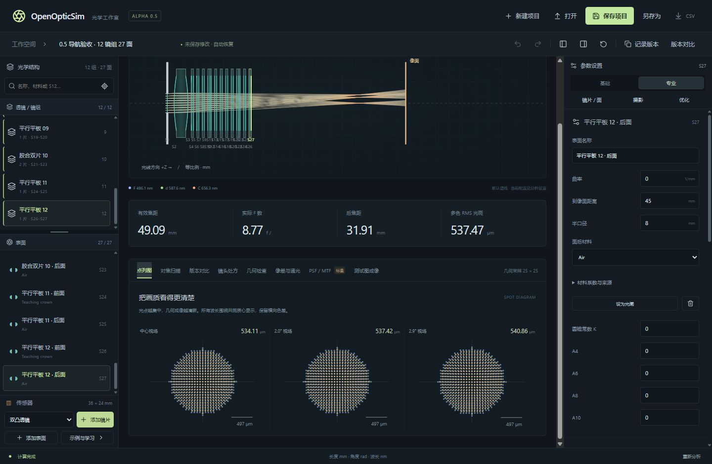

# OpenOpticSim 0.5.0 Alpha 验证记录

日期：2026-10-18；平台：Windows 11 x64。范围：独立滚动、复杂镜头结构导航、侧栏与布局记忆。上一版完整光学记录保留在 [0.4 报告](TEST_REPORT_0.4.md)，操作说明见 [NAVIGATION.md](NAVIGATION.md)。

## 已执行并通过

| 检查 | 结果 |
|---|---|
| Rust 回归 | 48 项：45 项核心物理/衍射/机械/工作流 + 3 项 Windows 保存与任务调度，全部通过 |
| 前端模型与保存 | 21 项：JSON/CSV、版本持久化、镜组编辑、对比尺度与波动显示密度，全部通过 |
| TypeScript / Vite | 生产构建通过 |
| 实际界面检查 | 16 项，使用真实 Rust CLI 和 12 镜组、27 面的教学压力算例 |
| 四区滚动 | 透镜、表面、参数与中央分析分别滚动，其他区域位置保持一致 |
| 滚动到边界 | 列表到达末尾后继续滚动，不带动其他列表或中央区域；整页保持 scrollTop=0 |
| 固定工作区 | 标题栏和项目栏可见，状态栏底边始终等于窗口高度 |
| 自动定位 | 从几何检查选择 S14，两个结构列表显示所属组与表面，参数回到顶部，中央滚动位置保持 850 px |
| 搜索与定位 | S22 筛选得到 1 镜组和 1 表面；选择后可清除过滤并自动定位，两列表恢复 12/27 项 |
| 外部选择 | 搜索 Teaching flint 后从光路用 Enter 选择独立光阑，隐藏该项的过滤自动清除 |
| 列表分隔条 | 键盘比例 45→50，鼠标拖动约 61；布局操作不改变已保存状态 |
| 侧栏收起 | 1280 px 窗口中中央宽度 740→980→1280 px，左右展开按钮保持可达 |
| 布局记忆 | 刷新后恢复两个侧栏收起状态与 61% 比例；恢复布局返回两侧展开、45% 比例 |
| 1000×720 | 页面、标题栏和项目栏无横向溢出；中央宽 526 px，优化设置可滚动访问 |
| 1440×940 | 中央宽 900 px，页面高度 940 px，状态栏底边 940 px |
| 键盘导航 | 表面列表 End 选择 S27，镜组与表面自动定位，参数显示末面 |
| 示例与学习 | 弹窗可打开并用 Escape 关闭，处方保持不变 |

原始测量：[validation-navigation.json](validation-navigation.json)。可复现压力处方：[navigation-stress.oos.json](fixtures/navigation-stress.oos.json)。该算例由原创教学组件组成，用于交互验收，未优化为商品镜头。

## 滚动测量示例

在 1280×720 视口、初始所有面板 scrollTop=0 的情况下：

| 操作后 | 透镜列表 | 表面列表 | 右侧参数 | 中央分析 | 整页 |
|---|---:|---:|---:|---:|---:|
| 滚动参数 | 0 | 0 | 373 | 0 | 0 |
| 滚动透镜 | 536 | 0 | 373 | 0 | 0 |
| 滚动表面 | 536 | 1323 | 373 | 0 | 0 |
| 滚动中央 | 536 | 1323 | 373 | 720 | 0 |
| 透镜末尾继续向下滚 | 536 | 1323 | 373 | 720 | 0 |

单位为 CSS 像素。标题栏 y=0，状态栏底边 y=720。透镜和表面标题位于各自滚动容器之外；参数模式切换和快速导航也不会随参数内容滚走。

## 实现与修复边界

- 工作区为固定窗口高度的网格，四个区域分别承担滚动；收起侧栏时显式固定各区列号，避免 CSS 自动排布将参数挤入中央列。
- 结构选中定位只改变目标列表 scrollTop，避免 scrollIntoView 连带移动祖先容器。
- 基础和专业模式都保留整组与表面导航。独立光阑只出现在表面列表中；胶合面仍共享原始处方。
- 布局偏好使用独立本机存储项，不写入 .oos.json 或版本库。光学模型、计算公式和项目格式没有修改。
- 0.5 未重新运行独立 RayOptics/NumPy 参考计算；既有 0.4 对照与本次全部 Rust 光学回归可用于评估。新增界面测量不构成新的光学精度声明。
- 实际交互验收在浏览器界面中调用真实 Rust CLI；原生 Windows 文件读写由现有测试覆盖，原生窗口手动全路径走查、干净无 WebView2 Windows 断网安装与代码签名仍未完成。

## 最终安装包

Tauri + NSIS 构建成功，0.5.0 x64，包含 WebView2 离线组件。大小 219380115 字节（209.22 MiB）。发布程序隐藏启动五秒，未退出、Responding=true、版本与标题正确。

安装包：target/release/bundle/nsis/OpenOpticSim_0.5.0_x64-setup.exe

SHA-256：BA2C73CEF2C8B8BC80B190487DAA1B1E3546ED90D64B4D05EDE409CE34F83CEE

发布程序 SHA-256：1CBA19230D94C67CCDC53984AFE6A8601BF1D7FF69F3AD2CE942757779EB6EFC

机器可读记录：[release-0.5.json](release-0.5.json)。
